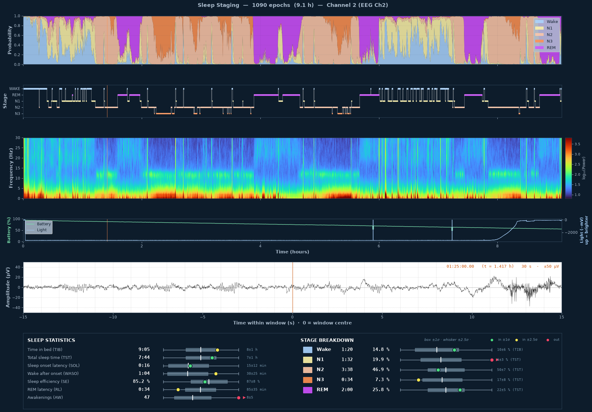
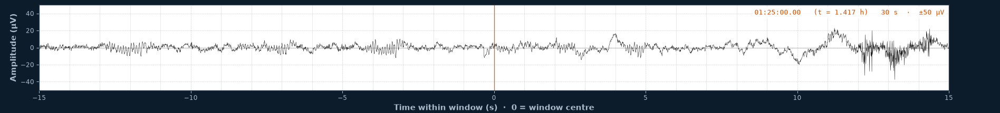
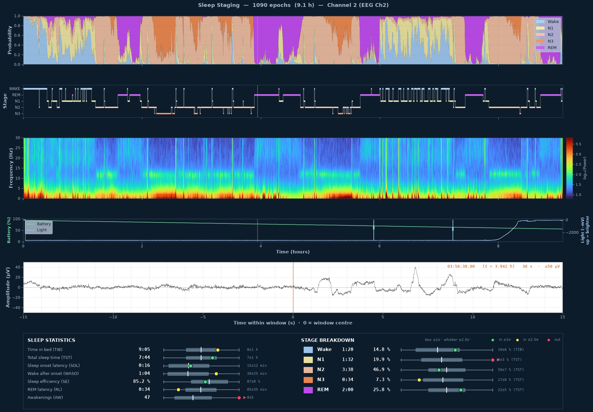
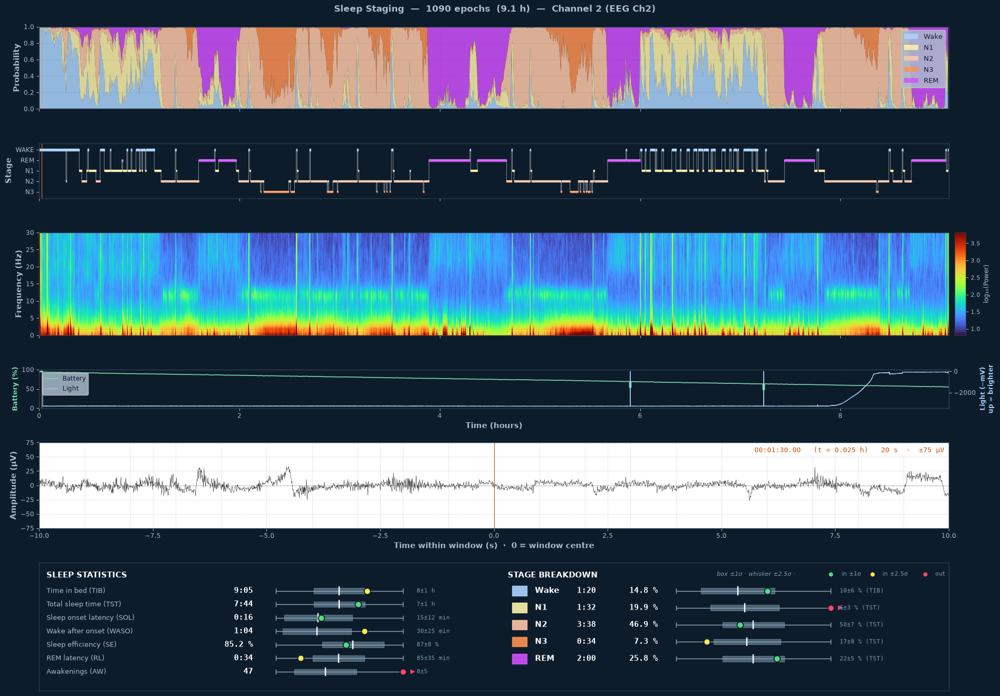
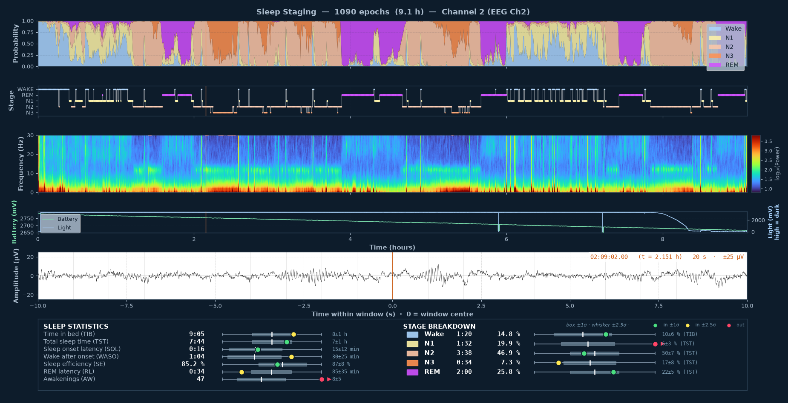
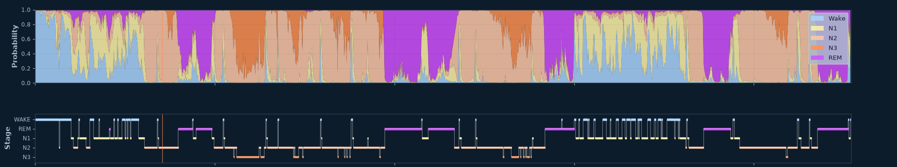
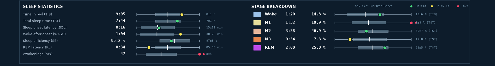

# Traumschreiber — offline analysis of your SD card recordings

**Look at a whole night of your own sleep on your computer: no app, no account, no internet
connection needed once it is set up.**



The [Traumschreiber](https://github.com/sd20-org/traumschreiber)
records every night as a BDF file on its microSD card. This repository contains a single Python
script that opens such a file, runs the open-source sleep-staging model
[AnySleep](https://github.com/dslaborg/AnySleep) on one EEG channel, and shows the result in an
interactive window:

| Panel | What you see |
|---|---|
| **Hypnodensity** | For every 30-second epoch, how likely the model thinks each stage is (Wake, N1, N2, N3, REM). Mixed colours mean the model is unsure. |
| **Hypnogram** | The most likely stage per epoch, as the classic step plot. |
| **Spectrogram** | Power per frequency over the night. Sleep spindles show up as a band at 12–14 Hz in N2, deep sleep as strong power below 4 Hz. |
| **Battery & light** | Battery charge in percent (same curve as the sd20 App) and the ambient light sensor, upwards = brighter. Handy to see when the lights went off and when the morning came. |
| **Raw EEG viewer** | The filtered EEG in µV at the moment you clicked, navigable with the arrow keys. |
| **Sleep statistics** | Time in bed, total sleep time, sleep latency, wake after sleep onset, efficiency, REM latency, awakenings and stage percentages, each compared with reference values for healthy adults. |

> The Traumschreiber is **not a medical device**, and neither is this script. The output is meant
> for education, research, citizen science and self-observation, not for diagnosing anything.
> AnySleep was trained on clinical polysomnography; a validation of the Traumschreiber against
> the sleep lab is under way (see the [Traumschreiber repository](https://github.com/sd20-org/traumschreiber#history)).

## Quick start

You need **Python 3.10 or newer**. Everything else is installed into a separate environment, so
your system Python stays untouched.

```bash
git clone https://github.com/sd20-org/Traumschreiber_Python_Offline-Data-Analysis.git
cd Traumschreiber_Python_Offline-Data-Analysis

python3 -m venv .venv
source .venv/bin/activate            # Windows: .venv\Scripts\activate

# CPU-only PyTorch is enough (and much smaller than the default download)
pip install torch --index-url https://download.pytorch.org/whl/cpu
pip install -r requirements.txt
```

Insert the microSD card, then:

```bash
python plot_sleep_scoring.py /media/$USER/TS2607-XXX/ADC/AD0021_20261020_2351.BDF --channel 0
```

On the first run the script downloads the AnySleep weights (`anysleep-run1.pth`, about 12 MB) from
the [AnySleep repository](https://github.com/dslaborg/AnySleep) and stores them next to the script.
After that it works offline. A 9-hour night takes about 30 seconds on an ordinary laptop CPU.

**Run it from any folder.** Use the absolute paths of the environment and the script; then the
current directory does not matter:

```bash
~/Traumschreiber_Python_Offline-Data-Analysis/.venv/bin/python \
  ~/Traumschreiber_Python_Offline-Data-Analysis/plot_sleep_scoring.py \
  /path/to/AD0021_20261020_2351.BDF --channel 2
```

## Where the recordings are on the SD card

```
TS2607-XXX/
├── ADC/
│   ├── AD0021_20261020_2351.BDF   ← one recording: number, start date, start time
│   ├── AD0021.SNX                 ← index file used by the app, not needed here
│   └── …
├── config.txt                     ← device settings (sample rate, gain, …)
├── firmware-version.txt
└── SOUNDS/
```

Each switch-on starts a new file. A full night is the large file whose name carries the date and
time you went to bed (about 22 MB per hour). Tiny files are short test switch-ons. You can analyse
the file directly on the card or copy it to your computer first; the script only reads it.

## Options

| Option | Default | Meaning |
|---|---|---|
| `--channel`, `-c` | `0` | EEG channel 0–7 that is fed to the model (see below) |
| `--start`, `-s` | `0` | Start of the analysed span, in seconds from the beginning of the file |
| `--duration`, `-d` | whole file | Length of the analysed span, in seconds |
| `--fmax` | `30` | Upper frequency of the spectrogram in Hz (5–60) |
| `--save FILE.png` | — | Write the figure to a PNG instead of opening the window |
| `--model PATH` | next to the script | Use a different copy of `anysleep-run1.pth` |
| `--model-type onnx` | `pth` | Run the ONNX export through onnxruntime instead (needs `pip install onnxruntime`) |

Example: analyse only hours 1 to 5 of the night:

```bash
python plot_sleep_scoring.py NIGHT.BDF --channel 2 --start 3600 --duration 14400
```

## Which channel?

The Traumschreiber has eight differential inputs, but only the ones with electrodes connected carry
EEG. Which channel that is depends on how your device is wired and where you placed the
electrodes. If you are unsure, run the script once per channel and compare the spectrograms:

- **A working EEG channel** shows clear structure over the night: a band of sleep spindles at
  12–14 Hz in N2, bright low frequencies in deep sleep, and a hypnogram with several sleep cycles
  of roughly 90 minutes.
- **An unconnected channel** looks the same all night. Its raw signal stays at a few µV (the noise
  floor of the amplifier), and the model output is mostly noise.

## The interactive window

Click anywhere on the hypnodensity, hypnogram, spectrogram or battery/light panel. The raw EEG at
that moment appears in the white panel, and an orange line marks the position in all panels.

| Key | Action |
|---|---|
| `←` / `→` | 10 s back / forward |
| `Shift` + `←` / `→` | one whole window back / forward |
| `↑` / `↓` | amplitude scale, ±25 µV … ±1000 µV |
| `+` / `−` | window width, 10 / 20 / 30 / 45 / 60 / 90 s |

The standard matplotlib toolbar (zoom, pan, save) works as usual.

### What the stages look like

| | |
|---|---|
|  | **N2:** short bursts of 12–14 Hz sleep spindles, for example around −12 s and −3 s. On the far right a movement artefact. |

<details>
<summary><b>More screenshots</b> (N3, REM, wake, empty window, laptop screenshot)</summary>

**N3, deep sleep:** slow waves of 0.5–2 Hz, 60-second window at ±75 µV.


**REM:** a quiet, low-amplitude background with slow deflections from the rapid eye movements
(the electrodes on the forehead pick up the eyes as well).



**Wake** right after switching the device on: fast muscle activity and movement.



**Right after opening:** the raw EEG panel waits for the first click.


**On a laptop screen**, 20-second window at ±25 µV, at 2:09 h in the night. This screenshot is
from a slightly earlier version, which still showed the battery in mV.



**Detail views:**





</details>

The screenshots show one night recorded with a TS2607 (channel 2, forehead electrodes, firmware
0.0.95).

## What the script does with the signal

1. **Read** the selected channel from the BDF file and convert it to µV with the header slope.
2. **Filter**: 50 Hz notch, then 0.3–35 Hz band-pass (zero-phase Butterworth) for the model, and a
   0.3 Hz high-pass only for the spectrogram and the raw EEG viewer.
3. **Resample** from 250 Hz to 128 Hz, the rate AnySleep expects.
4. **Clip and scale** robustly (median / interquartile range), so electrode offset and single
   artefacts do not dominate.
5. **Classify** with AnySleep, one probability per stage and 30-second epoch.
6. **Score** the night: the statistics follow the usual definitions (AASM); the reference ranges
   for healthy adults come from Ohayon et al. 2004 and Boulos et al. 2019.

The device itself records broadband and DC-coupled and applies no digital filter. All filtering
happens here, in the script.

## Data format

Current firmware writes **BDF** (BioSemi Data Format: the EDF layout with 24-bit samples).
Older recordings are 16-bit EDF; the script detects the format from the first header byte and
reads both.

| Signal | Rate | Unit | Notes |
|---|---|---|---|
| `EEG Ch0` … `EEG Ch7` | 250 Hz | µV | ADS131M08, 24 bit, differential |
| `Battery` | 1 Hz | mV | 2500 mV = 0 %, 2800 mV = 100 % (linear, as in the firmware and the app) |
| `Light` | 1 Hz | mV | ambient light sensor, **high value = dark** (≈ 3.3 V at night, tens of mV in daylight) |
| `ButtonEvent` | 1 Hz | — | button gestures, 0 = none |

Each data record is one second long. The µV value of a sample is the digital value times the
header slope `(phys_max − phys_min) / (dig_max − dig_min)`. With the default amplifier gain of
×4 (`ADS_GAIN=4` in `config.txt`) the header says ±300 000 µV over −8 388 608 … +8 388 607, so

```
1 digital unit = 600 000 µV / 16 777 215 ≈ 0.0358 µV
```

That comes from the internal 1.2 V reference of the ADC divided by the gain (1.2 V / 4 = ±300 mV
input range). The large range leaves headroom for the DC offset of electrodes on the skin; the
24-bit resolution means no usable EEG detail is lost. Because the script always reads the slope
from the header, it stays correct for any gain you set.

The files are standard enough for other tools as well, for example
[MNE-Python](https://mne.tools) (`mne.io.read_raw_bdf`) or [EDFbrowser](https://www.teuniz.net/edfbrowser/).

## Files

| File | Content |
|---|---|
| [`plot_sleep_scoring.py`](plot_sleep_scoring.py) | The analysis script: reader, preprocessing, inference, interactive figure, statistics |
| [`anysleep_no_hydra.py`](anysleep_no_hydra.py) | The AnySleep network architecture as a single file, from the [AnySleep repository](https://github.com/dslaborg/AnySleep) |
| [`requirements.txt`](requirements.txt) | Python packages |
| [`images/`](images/) | Screenshots for this page |

## Related

- **[Traumschreiber](https://github.com/sd20-org/traumschreiber)**:
  the device: schematic, photos, technical details, community projects.
- **Get-started tutorial, level 9 "Sleep staging"**:
  [English](https://sd20.org/isdt/en/projects/ts/get-started.html#level-9) ·
  [Deutsch](https://sd20.org/isdt/de/projects/ts/get-started.html#level-9).
  Nine levels from the first recording to a whole night, with this script at the end.
- **[sd20 App](https://play.google.com/store/apps/details?id=org.sd20.sd20app)**: records and
  scores the night on your phone, live over Bluetooth.

## Contributing

Issues and pull requests are very welcome. Ideas: automatic channel selection, export of the
hypnogram as CSV, support for more than one EEG channel. Questions:
[ts-repo@sd20.org](mailto:ts-repo@sd20.org).

## License and credits

The code in this repository is published under the [MIT License](LICENSE)
© 2026 Institute of Sleep and Dream Technologies (ISDT gemeinnützige UG, [sd20.org](https://sd20.org)).

`anysleep_no_hydra.py` and the model weights that the script downloads come from
[AnySleep](https://github.com/dslaborg/AnySleep) (MIT License, © 2026 dslaborg). If you use the
sleep staging in your research, please cite their work:

```bibtex
@article{Grieger2025,
    title = {AnySleep: a channel-agnostic deep learning system for high-resolution sleep staging in multi-center cohorts},
    author = {Niklas Grieger and Jannik Raskob and Siamak Mehrkanoon and Stephan Bialonski},
    year = {2025},
    eprint = {2512.14461},
    archivePrefix = {arXiv},
    url = {https://arxiv.org/abs/2512.14461},
}
```
